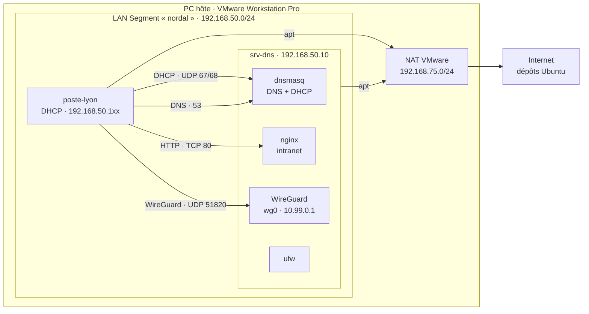

# 01 · Réseau de l'agence de Lyon

> **Ticket.** Depuis ce matin, les postes de l'agence de Lyon n'ouvrent plus `intranet.nordal.local`. Internet fonctionne. Priorité haute.

Objectif : monter le réseau de l'agence (DHCP, DNS, intranet, pare-feu, VPN), puis diagnostiquer des pannes réseau couche par couche et le documenter comme en entreprise.

## Livrables

| Document | Contenu |
| --- | --- |
| [Runbook : diagnostic réseau N2](docs/runbook-diagnostic-reseau.md) | Arbre de décision et commandes, couche par couche |
| [Compte rendu d'incident INC-2026-10-27](docs/incidents/INC-2026-10-27-port-80-filtre.md) | Panne « port 80 filtré par le pare-feu » : symptôme, diagnostic, cause, résolution, prévention |
| [Journal des incidents](docs/incidents/journal-incidents.md) | Les 7 incidents du chantier : 4 réels rencontrés pendant l'installation, 3 pannes simulées |
| [Configurations](config/) | Fichiers de configuration des deux machines, sans aucun secret |

## Architecture



Chaque VM a deux cartes : `ens33` en NAT pour l'accès Internet, `ens37` sur le LAN Segment `nordal`, isolé du réseau de la maison.

## Plan d'adressage

| Élément | Valeur |
| --- | --- |
| Réseau du TP | `192.168.50.0/24` (LAN Segment `nordal`, interface `ens37`) |
| srv-dns | `192.168.50.10` (adresse fixe) |
| Plage DHCP | `192.168.50.100` à `192.168.50.150`, bail de 12 h |
| Domaine | `nordal.local` |
| Intranet | `intranet.nordal.local` → `192.168.50.10` |
| Réseau du tunnel VPN | `10.99.0.0/24` : srv-dns `10.99.0.1`, poste-lyon `10.99.0.2` |
| Sortie Internet | NAT VMware `192.168.75.0/24`, passerelle `192.168.75.2` (interface `ens33`) |

## Services de srv-dns

| Service | Logiciel | Port | Configuration |
| --- | --- | --- | --- |
| DNS | dnsmasq | 53 | [`etc/dnsmasq.d/nordal.conf`](config/srv-dns/etc/dnsmasq.d/nordal.conf) |
| DHCP | dnsmasq | UDP 67 | même fichier |
| Intranet | nginx | TCP 80 | [`var/www/html/index.html`](config/srv-dns/var/www/html/index.html) |
| VPN | WireGuard | UDP 51820 | [`etc/wireguard/wg0.conf`](config/srv-dns/etc/wireguard/wg0.conf) |
| Pare-feu | ufw | | [`ufw-regles.sh`](config/srv-dns/ufw-regles.sh) |

## Choix techniques

- **dnsmasq pour le DNS et le DHCP** : un seul service à administrer pour un petit site.
- **`bind-interfaces`** : dnsmasq n'écoute que sur `ens37`. Sans cette option, il entre en conflit avec `systemd-resolved`, qui occupe déjà le port 53 en local.
- **Aucune passerelle annoncée par DHCP (`dhcp-option=3`)** : sur ce réseau isolé, aucune machine ne joue le rôle de routeur. Annoncer srv-dns comme passerelle ferait passer la route par défaut du poste par le serveur, et le poste perdrait sa sortie Internet par le NAT.
- **Domaine de recherche `nordal.local` distribué au poste** (`use-domains: true`) : le poste a deux serveurs DNS, celui du NAT et srv-dns. Il envoie ainsi les noms en `.nordal.local` à srv-dns et le reste au NAT.
- **Pare-feu en refus par défaut** : tout le trafic entrant est refusé, sauf SSH, DNS, DHCP, HTTP et WireGuard.
- **Clé privée WireGuard hors de la configuration** : elle reste dans `/etc/wireguard/private.key` (droits `600`) et est chargée au démarrage par `PostUp = wg set %i private-key …`. Les fichiers `wg0.conf` publiés ici ne contiennent aucun secret.
- **`AllowedIPs` en `/32`** : chaque pair n'a droit qu'à sa propre adresse dans le tunnel (moindre privilège).

## Preuve que le VPN chiffre le trafic

Capture sur srv-dns pendant un `curl http://10.99.0.1` lancé depuis poste-lyon. À l'intérieur du tunnel (`wg0`), l'échange HTTP est lisible :

```
listening on wg0, link-type RAW (Raw IP), snapshot length 262144 bytes
IP 10.99.0.2.58410 > 10.99.0.1.80: Flags [S], ... options [mss 1380,...], length 0
IP 10.99.0.1.80 > 10.99.0.2.58410: Flags [S.], ... length 0
IP 10.99.0.2.58410 > 10.99.0.1.80: Flags [P.], seq 1:74, ... length 73: HTTP: GET / HTTP/1.1
IP 10.99.0.1.80 > 10.99.0.2.58410: Flags [P.], seq 1:271, ... length 270: HTTP: HTTP/1.1 200 OK
```

Sur la carte réelle (`ens37`), le même échange n'apparaît que sous forme de paquets UDP 51820 au contenu illisible. Les captures d'écran comparatives sont dans [`captures/`](captures/).

Deux indices confirment le tunnel : `link-type RAW` (pas d'en-tête Ethernet sur `wg0`) et `mss 1380` (taille réduite pour laisser la place à l'en-tête de chiffrement).

## Compétences mises en œuvre

Adressage IP et sous-réseaux, DHCP, DNS, HTTP, filtrage avec état, VPN WireGuard, virtualisation VMware (NAT, LAN Segment, snapshots, clonage), diagnostic réseau méthodique, analyse de trames avec tcpdump, gestion des secrets, rédaction de procédures et de comptes rendus d'incident.
