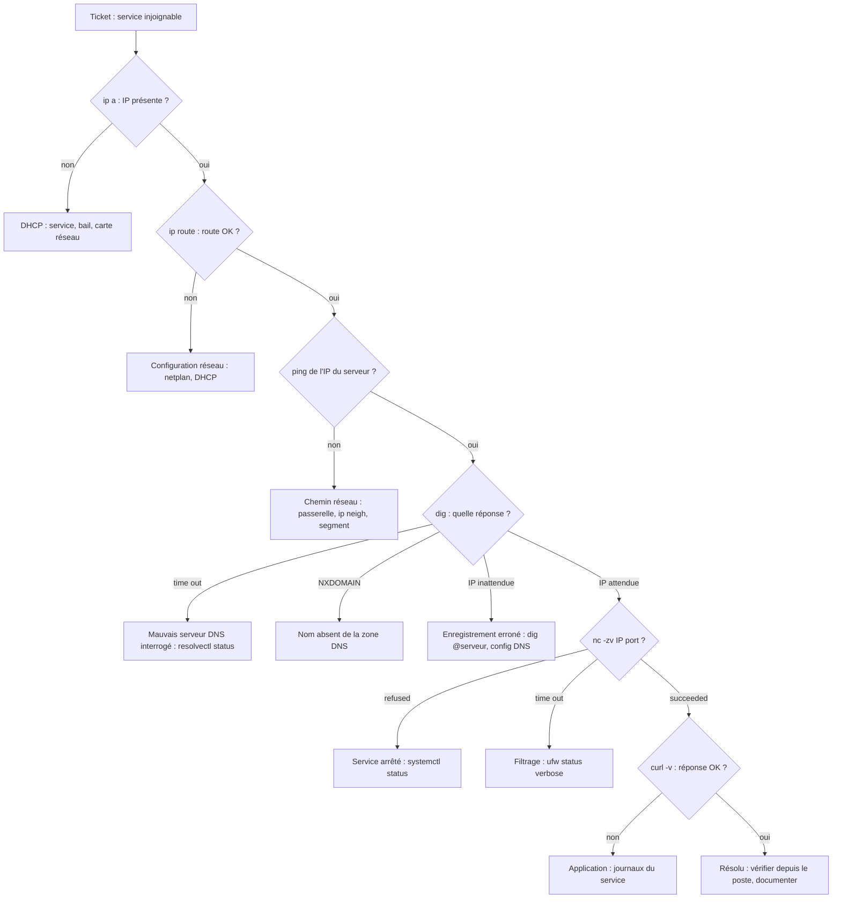

# Runbook : diagnostic réseau N2

**Objet.** Diagnostiquer un service réseau injoignable (« l'intranet ne répond plus ») de façon méthodique et reproductible.

**Principe.** On teste les couches dans l'ordre, du poste vers le service, et on s'arrête à la première qui échoue : c'est là que se trouve la panne. Trois règles :

1. Tester **depuis le poste de l'utilisateur**, pas seulement depuis le serveur.
2. **Comparer chaque résultat à la valeur attendue**, pas seulement vérifier qu'il y a une réponse.
3. Noter chaque commande et son résultat au fur et à mesure.

## Arbre de décision

## Commandes par couche

| Couche | Question | Commande | Résultat normal | Signe de panne |
| --- | --- | --- | --- | --- |
| Adresse | Le poste a-t-il une IP ? | `ip a` | IP dans la plage DHCP | pas d'IP, ou IP hors plage |
| Route | Sait-il joindre le réseau ? | `ip route` | ligne vers `192.168.50.0/24` | route absente |
| Joignabilité | Le serveur répond-il ? | `ping -c 3 <IP serveur>` | 0 % de perte | perte totale, `Destination Host Unreachable` |
| Nom | Le nom se résout-il, et vers quoi ? | `dig <nom>` puis `dig @<serveur DNS> <nom>` | IP attendue | `time out`, `NXDOMAIN`, IP inattendue |
| Serveur DNS du poste | À qui le poste pose-t-il la question ? | `resolvectl status <carte>` | serveur attendu | autre adresse |
| Port | Le service accepte-t-il la connexion ? | `nc -zv <IP> <port>` | `succeeded` | `refused` ou `timed out` |
| Application | Le service répond-il correctement ? | `curl -v http://<nom>` | `200 OK` | erreur HTTP, attente sans fin |
| Filtrage | Une règle bloque-t-elle ? | `sudo ufw status verbose` (serveur) | port en `ALLOW` | `DENY` ou port absent |

## Lire les messages

| Message | Signification |
| --- | --- |
| `Destination Host Unreachable` renvoyé par la propre IP du poste | la passerelle ne répond pas au niveau 2 (ARP) : vérifier `ip neigh` |
| `dig` en `time out` | aucun serveur DNS n'a répondu : le poste interroge peut-être une mauvaise adresse |
| `NXDOMAIN` | un serveur a répondu, mais ne connaît pas le nom |
| `Connection refused` | la machine répond, mais aucun service n'écoute sur ce port |
| `Connection timed out` | aucune réponse : paquets jetés par un filtrage |

## Pièges connus

- **Tester depuis le serveur ne prouve rien pour le client** : le trafic local ne passe pas par les mêmes règles de pare-feu.
- **Le serveur ne résout pas forcément ses propres noms** : srv-dns résout ses noms par le DNS du NAT, qui ne connaît pas `nordal.local`. Sur le serveur, tester avec l'adresse IP.
- **Cache DNS du poste** : après une correction DNS, lancer `resolvectl flush-caches` avant de retester.
- **Une erreur de résolution de nom peut cacher une panne réseau** : si `ping` vers une IP échoue aussi, ce n'est pas le DNS.

## Clôture

1. Appliquer la correction, puis **revérifier depuis le poste** de l'utilisateur.
2. Rédiger le compte rendu : symptôme, diagnostic, cause, correction, prévention.
3. Mettre à jour cette procédure si un nouveau cas est apparu.
