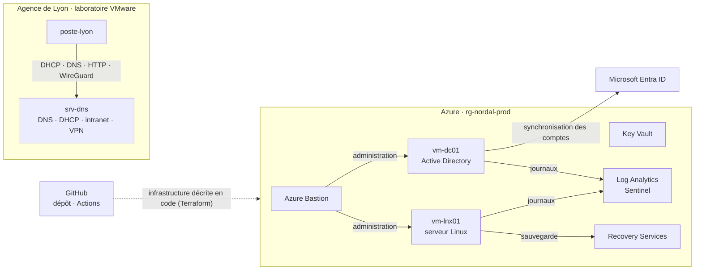

# Nordal SysOps

Projet personnel : construire, sécuriser et exploiter le système d'information d'une entreprise fictive, chantier par chantier, en le documentant comme en entreprise.

## Contexte

**Nordal Assurances** est un courtier en assurances de 180 salariés, avec un siège à Paris et une agence à Lyon. Son système d'information est hybride : un Active Directory sur site, Microsoft 365 et Entra ID, quelques serveurs Linux, et une migration en cours vers Azure.

Dans ce scénario, je viens d'être recrutée comme SysOps. Chaque chantier part d'un ticket ou d'une demande, comme on en reçoit en entreprise, et se termine par des livrables qu'un collègue pourrait reprendre : configurations, runbooks, comptes rendus d'incident.

L'objectif est de pratiquer l'administration systèmes et réseaux avec une orientation sécurité : diagnostic méthodique, gestion des identités, automatisation, supervision, sauvegarde et documentation.

> Nordal Assurances est une entreprise fictive. Les noms, adresses et utilisateurs de ce dépôt sont fictifs, et aucun secret n'y est publié.

## Feuille de route

| N° | Chantier | Demande de départ | Technologies | État |
| --- | --- | --- | --- | --- |
| 01 | [Réseau de l'agence de Lyon](01-reseau-agence-lyon/) | « L'agence de Lyon n'accède plus à l'intranet » | DHCP, DNS (dnsmasq), nginx, ufw, WireGuard, tcpdump, VMware | Terminé |
| 02 | Landing zone Azure | « Préparer la landing zone de la migration » | Terraform, VNet, NSG, Azure Bastion, Key Vault, GitHub Actions | À venir |
| 03 | Active Directory | « Monter le domaine nordal.local » | AD DS, DNS, GPO, modèle AGDLP, realmd et sssd | À venir |
| 04 | Identités Entra ID | « Sécuriser les identités avant l'audit » | Entra Connect, accès conditionnel, PIM, RBAC Azure | À venir |
| 05 | Automatisation | « Arrivées, départs et revue des droits » | PowerShell, Microsoft Graph, Ansible | À venir |
| 06 | Supervision et sécurité | « Quelqu'un essaie de deviner des mots de passe » | Log Analytics, KQL, Microsoft Sentinel, Azure Monitor | À venir |
| 07 | Sauvegarde et reprise | « Un serveur a été chiffré, peut-on restaurer ? » | Proxmox VE, vzdump, Azure Backup, RPO et RTO | À venir |
| 08 | Exploitation et astreinte | « La journée d'astreinte » | L'ensemble du SI, main courante | À venir |

## Architecture cible

Elle se construit chantier par chantier ; seul le site de Lyon (chantier 01) est en place aujourd'hui.



## Organisation du dépôt

Un dossier par chantier, numéroté dans l'ordre de lecture et nommé par périmètre :

```
01-reseau-agence-lyon/
├── README.md        contexte, architecture, choix techniques
├── docs/
│   ├── runbook-…            procédures d'exploitation
│   └── incidents/           comptes rendus INC-AAAA-MM-JJ-sujet.md
├── config/          fichiers de configuration, sans secret
└── captures/        preuves (captures d'écran)
```

## Méthode de travail

- **Une branche par chantier**, portant le nom du dossier, fusionnée dans `main` par une pull request.
- **Aucun secret dans le dépôt** : clés et états exclus par `.gitignore`, clés privées gardées hors des fichiers de configuration.
- **Chaque incident est documenté** : symptôme, diagnostic, cause, correction, prévention.
- **Diagnostic couche par couche** : adresse, route, joignabilité, nom, port, service, filtrage.
- **Coûts maîtrisés** : alerte de budget Azure et ressources éteintes ou détruites après chaque séance.

## Environnement

| Élément | Usage |
| --- | --- |
| VMware Workstation Pro | Laboratoire local : machines virtuelles Ubuntu Server, réseau isolé, snapshots |
| Microsoft Azure | Infrastructure cloud, à partir du chantier 02 |
| Terraform, Azure CLI | Infrastructure décrite en code |
| PowerShell 7, Bash | Administration et automatisation |
| Git, GitHub, VS Code | Versionnement, revue et documentation |

## Auteure

Mame Diarra Gueye, certifiée AWS Solutions Architect – Associate. Ce projet accompagne ma préparation à un poste SysOps orienté sécurité.
